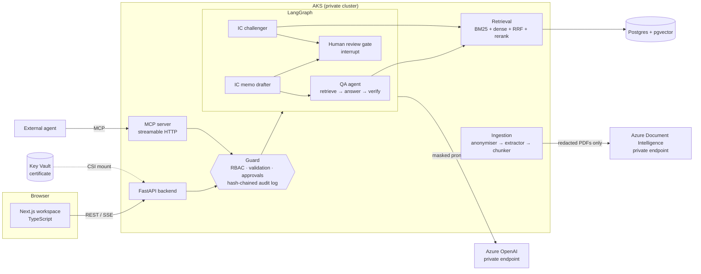

# dealroom-copilot

An agentic due-diligence assistant for private-equity deal teams, built as a public reference implementation.
It ingests a data room (PDFs, spreadsheets, scans), answers analysts' questions with a citation for every claim,
drafts an investment committee (IC) memo, and runs an **IC challenger** agent that builds the strongest case
*against* the deal. Nothing is approved until a named partner has reviewed the memo and answered every serious
objection. The setting is fictional: Northgate Capital Partners, a mid-market fund, is considering a majority
buyout of Alpine Precision Components AG, a Swiss machining supplier. Every document, figure and person in the data
room is synthetic and generated by a script in this repository.


Everything runs offline: `make test`, `make eval` and `make demo` need no API keys (stub model, local OCR, local
embeddings). The same code switches to Azure OpenAI and Azure Document Intelligence behind private endpoints with
environment variables, and deploys to AKS with Terraform and Helm.

## Architecture



| Layer | What it does | Where |
| --- | --- | --- |
| Data room | 37 synthetic files: IM, management presentation, audited accounts FY2023–FY2025, five customer contracts, two leases, CVs, legal/commercial/tax DD, board minutes, a facilities term sheet, a financial model with an LBO tab, four image-only scans, 24 months of management accounts | `data/dataroom`, generated by `backend/dealroom/synth` |
| Ingestion | Anonymiser first; layout-aware extraction (pdfplumber + PyMuPDF + openpyxl, Tesseract for scans) or Azure Document Intelligence `prebuilt-layout`; chunks keep page or sheet-and-row coordinates | `backend/dealroom/ingestion` |
| Retrieval | BM25, dense vectors (local LSA model offline, Azure OpenAI embeddings in the cloud, ONNX `bge-small` optional), reciprocal rank fusion, second-stage reranker; in-memory or Postgres + pgvector (HNSW) | `backend/dealroom/retrieval` |
| Agents | LangGraph: QA with abstention and citation verification, IC memo drafter, IC challenger, review gate that pauses the graph until a human decides | `backend/dealroom/agents` |
| Tools | MCP server: `search_dataroom`, `get_document_excerpt`, `get_financial_metric`, `create_diligence_item`, `draft_memo`, `export_memo` | `mcp_server/dealroom_mcp` |
| Workspace | Data room browser, streamed cited answers with source highlighting, memo review with the challenger panel, export approval, audit view | `web` |
| Platform | Terraform (AKS, Azure OpenAI, Document Intelligence, Postgres Flexible Server, Key Vault, ACR, private endpoints, Entra ID app with certificate), Helm chart, GitHub Actions | `infra`, `.github` |

## Results

From [`reports/eval.md`](reports/eval.md), regenerated by `make eval` and checked in CI (the build fails if the
committed report is out of date). Offline configuration: stub model, local LSA embeddings, lexical reranker.

**Retrieval** (105 answerable questions, 130 chunks)

| Method | Recall@3 | Recall@5 | Recall@10 | nDCG@10 | MRR |
| --- | --- | --- | --- | --- | --- |
| BM25 | 97.1% | 98.1% | 98.6% | 0.947 | 0.948 |
| Dense (local LSA) | 95.7% | 97.1% | 97.6% | 0.909 | 0.904 |
| Hybrid (RRF) | 96.2% | 97.1% | 98.1% | 0.943 | 0.949 |
| Hybrid + rerank | 95.7% | 96.2% | 97.6% | 0.946 | 0.947 |

Offline, hybrid + rerank does **not** beat BM25 on this corpus (recall@10 −1.0 pt, MRR −0.001). The questions
share vocabulary with the documents and the offline models are lexical, so there is no semantic gap for them to
close. `make eval-onnx` reruns the same evaluation with a pre-trained embedding model and a trained cross-encoder
(the CI job `onnx-eval` publishes `reports/eval_onnx.md`); that is the configuration in which a lift is expected,
and this section will quote it once measured.

**Answers** (117 questions, 12 of them unanswerable from the data room)

| Metric | Value |
| --- | --- |
| Citation precision (cited chunk holds the gold evidence) | 86.6% |
| Groundedness (answer words found in cited evidence) | 98.1% |
| Numeric accuracy (72 questions with a figure) | 94.4% |
| Abstention accuracy (all questions) | 93.2% |
| Abstention precision / recall (unanswerable questions) | 64.3% / 75.0% |

**IC challenger**: the data room contains three planted problems. The challenger is not told about them; it
runs generic checks (figures in marketing documents against audited accounts, termination rights weighted by
revenue share, covenant headroom with a downside case, milestones dated differently across documents).

| Planted issue | Found |
| --- | --- |
| FY2025 revenue in the IM (CHF 148.6m) does not match the audited accounts (CHF 142.3m) | yes |
| Largest customer (31.2% of revenue) can terminate on change of control; legal DD has not reviewed the contract | yes |
| FY2026 net leverage 4.38x against a 4.50x covenant; the chair's note on a CHF 4m shortfall takes it to the limit | yes |

Every challenger citation quotes the cited chunk verbatim (100%). The challenger also raises five arguments that
were not planted but are true of the data: the EV-7 start-of-production slip recorded only in a handwritten note,
the thin FY2027 headroom, an adjusted EBITDA with no bridge, customer concentration, and the existing loan's
change-of-control repayment.

**Ingestion and data protection**: OCR character accuracy 99.5–100% on the four scans; 0 of 10 personal-data
strings reach the index; 0 of 10 survive in the redacted PDFs.

## Security and data protection

Two separate mechanisms, because they protect against different things.

**1. Anonymisation before anything leaves the trust boundary (protects the content).**
Before a PDF is sent to Document Intelligence, `Anonymiser.redact_pdf` rewrites the file itself: names, emails,
phone numbers, IBAN-like strings and addresses are replaced by placeholders such as `[PERSON_001]`. Image-only pages
are OCR'd locally first and the matching word boxes are blacked out in the image. Extracted text is masked again
with the same vault, so the index and every model prompt only contain placeholders, and questions are masked before
search. The vault (placeholder ↔ original) stays on the server; the masking log stores type, placeholder and a
SHA-256 prefix, never the value. A test asserts that a remote extractor only ever receives redacted bytes.

**2. Private endpoints with certificate authentication (protects the channel and the identity).**
Azure OpenAI and Document Intelligence have public network access and key authentication disabled; they are only
reachable through private endpoints in the cluster's virtual network. The backend authenticates as an Entra ID
service principal using a private key and an X.509 certificate (a signed JWT client assertion, no client secret).
The certificate is generated inside Key Vault and never exported to Terraform state or a laptop; pods mount it
read-only through the Secrets Store CSI driver, using a workload identity that may read that one object only.

**Around them**

- *RBAC*: analysts read and record diligence items; associates also draft; partners also approve and export.
  Deny by default. The same guard serves the web API and the MCP server.
- *Validated arguments*: strict Pydantic models (unknown fields rejected, sizes bounded) before any tool runs.
- *Human approval for side effects*: `export_memo` first returns an approval id; it runs once, after a partner
  approves that id.
- *Audit*: every call, denial, approval and review decision goes to an append-only JSONL log in which each record
  holds the SHA-256 of the previous one. `AuditLog.verify` reports the first tampered line; the UI shows the result.
- *Human review*: the memo cannot be approved with an uncited sentence, by anyone but a partner, or before every
  high-severity challenger argument has a written response. These rules live in `agents/review.py`, not the UI.
- *Identity in the cluster*: the ingress authenticates users with Entra ID (oauth2-proxy) and overwrites the
  `X-User` / `X-Role` headers the backend trusts. Network policies deny ingress by default.

## Quickstart (offline)

Requirements: Python 3.11+, Node 22, Tesseract.

```bash
make install        # pip install -e ".[dev]" and npm ci
make test           # pytest, coverage >= 90%
make eval           # reports/eval.md
make demo           # question -> cited answer -> memo -> challenger -> refused approval -> approval
make api            # http://localhost:8000
make web            # http://localhost:3000 (second terminal)
make e2e            # Playwright: the full flow in a browser
```

Or with Docker: `make up` (Postgres + pgvector, backend, MCP server on :8001, web on :3000).

MCP clients (Claude Desktop, VS Code, agent frameworks) can start the server over stdio with
`DEALROOM_USER=me DEALROOM_ROLE=analyst dealroom-mcp`.

## Cloud deployment

```bash
cd infra/terraform
cp example.tfvars terraform.tfvars          # subscription, region, runner IP for Key Vault
terraform init -backend-config=...          # remote state in your storage account
terraform apply
terraform output helm_values                # copy into values.cloud.example.yaml

az acr build -r <acr> -t dealroom-copilot-backend:0.1.0 -f backend/Dockerfile .
az acr build -r <acr> -t dealroom-copilot-web:0.1.0 web
helm upgrade --install dealroom infra/helm/dealroom-copilot -n dealroom --create-namespace \
  -f infra/helm/dealroom-copilot/values.cloud.example.yaml
```

Terraform creates: resource group, virtual network with subnets for AKS, private endpoints and Postgres; private DNS
zones; AKS (Azure CNI overlay with Cilium, workload identity, Key Vault CSI driver, Entra ID RBAC, local accounts
disabled); Azure OpenAI with chat and embedding deployments; Document Intelligence; Postgres Flexible Server 16 with
`vector` enabled; Key Vault with the client certificate and the database URL; ACR; the Entra ID application with
its certificate credential and least-privilege role assignments. The Helm release runs an ingest job, then the
backend, MCP server and web workspace. CI runs `terraform validate` and `helm lint` for both value sets.

Environment variables (cloud mode): `DEALROOM_EXTRACTOR=azure`, `DEALROOM_LLM=azure`, `AZURE_TENANT_ID`,
`AZURE_CLIENT_ID`, `AZURE_CLIENT_KEY_PATH`, `AZURE_CLIENT_CERT_PATH`, `AZURE_OPENAI_ENDPOINT`,
`AZURE_OPENAI_DEPLOYMENT`, `AZURE_DOCINTEL_ENDPOINT`, `DATABASE_URL`. `DEALROOM_LLM=openai` with `OPENAI_API_KEY`
also works for local experiments.

## Design choices

- **Citations are enforced, not requested.** The verifier drops any citation that points at evidence the model was
  not given, and an answer without a valid citation becomes an abstention. The memo writer keeps a sentence only if
  it carries its own valid citation. This holds for any model provider.
- **Chunks never cross a page or a spreadsheet block,** so every citation is exact: `file, p. 2` or
  `file, sheet LBO, rows A14:A21`. Table rows are answered at cell level when the question names a year or column.
- **The challenger runs checks, not prompts.** Each check is a function a reviewer can read and test; a language
  model can phrase the argument, but the facts and citations come from retrieval.
- **The review gate is a LangGraph interrupt.** The graph stops and can only resume with a decision from a person;
  requested changes send it back to drafting.
- **One guard for humans and agents.** Web routes and MCP tools call the same policy and write to the same log.
- **Evidence locations come from the generator.** Gold questions reference a text needle; the generator resolves it
  to a page or a cell and fails the build if a needle matches zero or several places.

## Limitations

- The corpus is synthetic and small (37 files, 130 chunks); scores are higher than on a real data room.
- Questions share vocabulary with the documents, which favours BM25; offline, hybrid + rerank shows no lift.
- Abstention in the offline stub is a lexical coverage threshold: 3 of 12 unanswerable questions are answered
  anyway and 5 of 105 answerable ones are withheld. With a real model, its own "insufficient evidence" reply adds a
  second gate; that configuration is not measured in CI.
- Thresholds, the lexical reranker and the abstention rule were developed against this same gold set; there is no
  held-out split.
- With the stub model, answer metrics measure retrieval and evidence selection, not generation.
- The handwritten board note is rendered in an oblique font with jitter, not real handwriting.
- Person detection uses a first-name lexicon; it is measured here only on the data room's own personal data and
  should be replaced by an NER model behind the same interface for real documents.
- The challenger's checks cover the issue types it was designed for; it does not claim to find everything.

## Licence

MIT, © 2026 Ronald Nyami. All data in this repository is synthetic.
