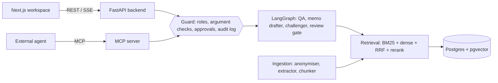

# Architecture

## Modules

| Folder | What it does |
| --- | --- |
| `backend/dealroom/synth` | Generates the 37-file data room, the 117 gold questions and the three planted problems. Gold questions point at a text snippet; the generator resolves it to a page or a spreadsheet row and fails if the snippet matches zero or several places. |
| `backend/dealroom/ingestion` | Anonymiser, extraction (pdfplumber, PyMuPDF, openpyxl, Tesseract for scans, or Azure Document Intelligence), chunking. A chunk never crosses a page or a block of spreadsheet rows, so each citation points at one exact place. |
| `backend/dealroom/retrieval` | BM25, dense vectors (local LSA offline; Azure OpenAI or ONNX `bge-small` optional), reciprocal rank fusion, reranker; in memory or Postgres + pgvector. |
| `backend/dealroom/agents` | QA agent, IC memo drafter, IC challenger, review state machine, LangGraph graphs. |
| `backend/dealroom/evaluation` | Metrics and the report in `reports/eval.md`. |
| `backend/dealroom/realdata` | Downloads FinanceBench and CUAD by checksum, indexes each filing on its own, and scores retrieval (evidence page in the top k) and the change-of-control detector against human labels. Report in `reports/eval_real.md`. |
| `mcp_server/dealroom_mcp` | MCP tools, role policy, approvals, hash-chained audit log. |
| `web` | Next.js workspace and the Playwright test. |
| `infra` | Terraform and Helm. See [deployment.md](deployment.md). |

## How an answer is produced

1. The question is masked with the same anonymisation vault as the documents.
2. BM25 and dense search each return 30 candidates; reciprocal rank fusion merges them; the reranker reorders.
3. The top chunks are split into sentences or table rows. When the question names a year or column, only that cell is kept.
4. If the best passage covers less than 45% of the question's content words, the agent answers "Not found in the data room".
5. Otherwise the model answers from numbered evidence. Any citation number it invents is removed, and an answer left without a valid citation becomes an abstention.

## The challenger

The challenger is a set of plain functions, one per check, each using retrieval only:

- full-year figures in the IM or management presentation against the audited accounts;
- contract clauses that allow termination on a change of control, weighted by the customer's share of revenue;
- covenant limits in the term sheet against the model's projections, plus a downside case when a document mentions a revenue shortfall;
- the same milestone dated differently in two documents;
- adjusted EBITDA quoted without a bridge;
- customer concentration.

A language model can phrase an argument, but the figures and quotes come from the documents.

## Review gate

The deal graph stops at a LangGraph `interrupt` and resumes only with a decision from a named person. The rules live in `agents/review.py`: only a partner approves, no memo with an uncited sentence is approved, and every high-severity challenger argument needs a written response first. Requested changes send the graph back to drafting.
